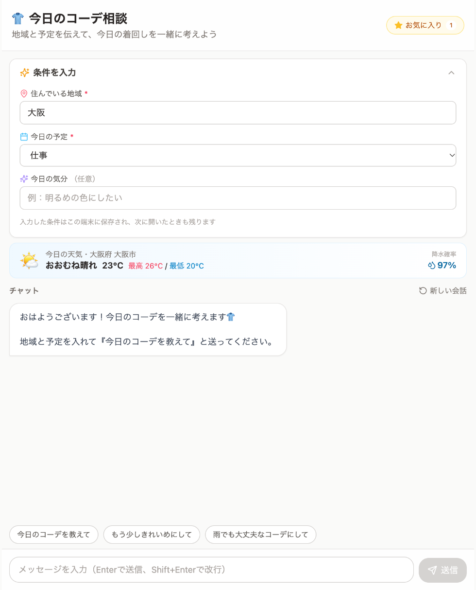
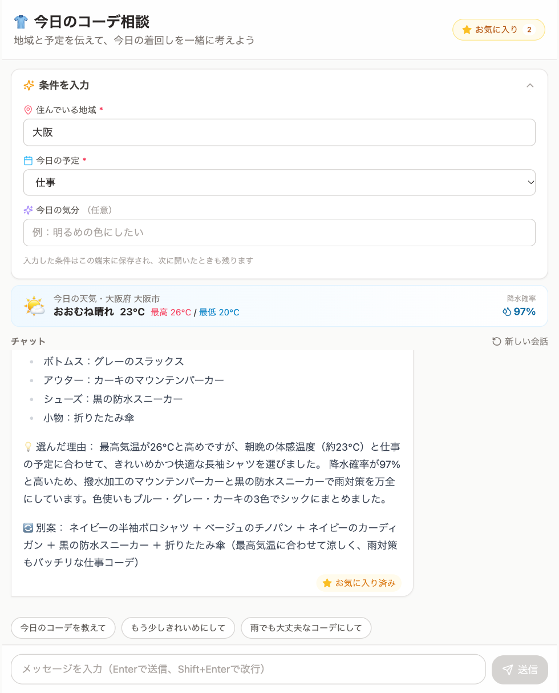
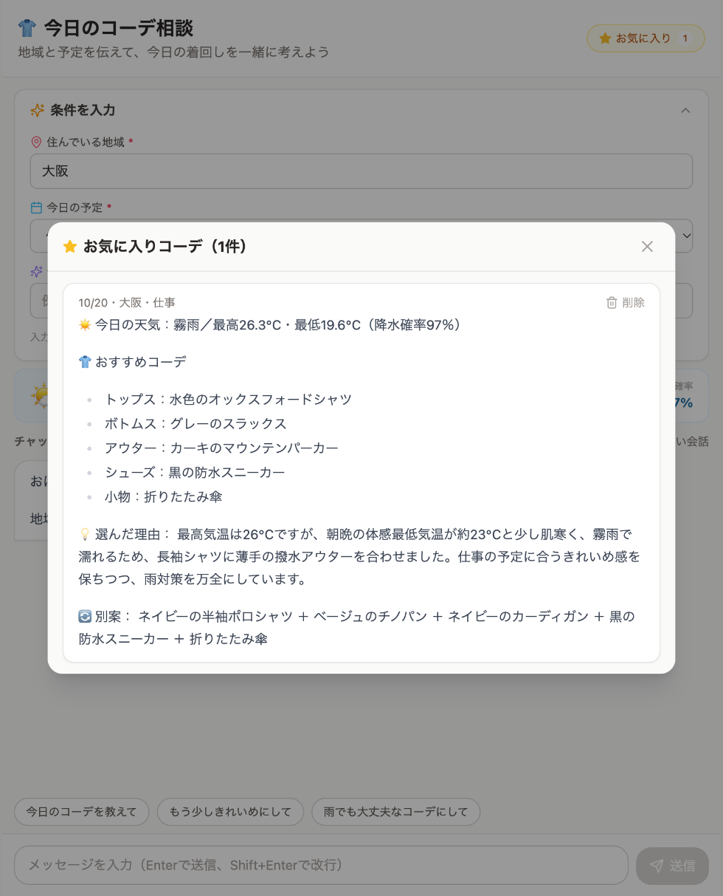
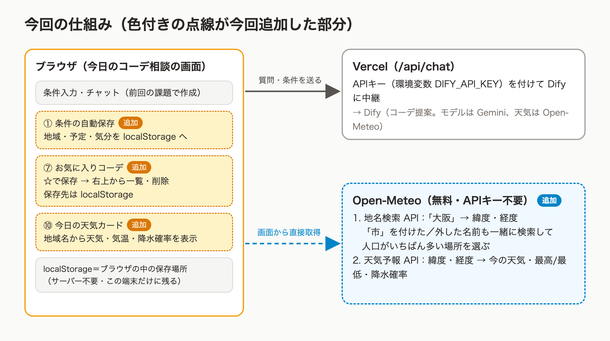

# [課題提出] 今日のコーデ相談アプリに実用的な機能を3つ追加する実装課題を完成させました

> このファイルは提出記事の原稿です（`zsh docs/copy_article.sh` で写真ごとコピーできます）。

## A. 課題概要

### 課題情報

- 課題名：課題7-3 課題2　作成したWebアプリに実用的な機能を3つ追加しよう
- 難易度：★★★☆☆（5段階で自己評価）

### 課題要件

- 前回の課題で作った「今日のコーデ相談」アプリ（Difyのチャットボットと API 連携したWebアプリ）に、実用的な機能を3つ追加する
- 追加した3つの機能：
  1. 条件の自動保存（地域・予定・気分を覚えておき、次に開いたときも入った状態にする）
  2. お気に入りコーデ（気に入った提案を☆で保存し、あとで一覧で見返す）
  3. 今日の天気カード（地域を入れると、天気・気温・降水確率がひと目でわかる）
- 前回の提出物を残すため、別のプロジェクトとして作成・公開した

### ソースコード

- GitHub：https://github.com/Usuke3122378/outfit-chat-plus
- Google Drive：なし
- 公開URL：https://outfit-chat-plus.vercel.app/

### 成果物のスクリーンショット

メイン画面（再読み込みしても地域・予定が残っている。条件の下に今日の天気カード）

お気に入り（提案の下の☆を押すと「お気に入り済み」になり、右上の数字が増える）

お気に入り一覧（右上の「お気に入り」から開く。日付・地域・予定つきで見返せて、削除もできる）

## B. 実装内容

### 使用技術

- 言語：TypeScript（画面）、JavaScript（APIキーを付けて中継するサーバー処理。今回は変更なし）
- フレームワーク：React、Vite、Tailwind CSS
- データベース：なし（条件とお気に入りは、ブラウザの中の保存場所 localStorage に保存）
- その他ツール：Claude Code（機能の相談・実装・動作確認）、Open-Meteo（天気。無料・APIキー不要）、Dify Cloud（チャットボット本体）、GitHub（コード保管）、Vercel（公開。push すると自動で公開し直す）、lucide-react（☆や雨粒のアイコン）

### 実装した機能

1. 条件の自動保存：地域・予定・気分を入力するたびに localStorage に保存し、次に開いたときに最初から入れておく。毎朝「大阪」と打ち直さなくてよい
2. お気に入りコーデ：ボットの提案の下に「☆お気に入り」ボタンを表示。押すと保存され、もう一度押すと外せる。ヘッダー右上の「お気に入り」ボタン（件数つき）から一覧を開き、日付・地域・予定つきで見返したり削除したりできる
3. 今日の天気カード：地域を入れて0.8秒たつと、条件欄の下に天気のアイコン・今の気温・最高/最低気温・降水確率を表示する。見つからない地名のときは「市区町村名で入れてみてください」と案内する

### 工夫したポイント

- 地名検索の表記ゆれ対策：Open-Meteo の地名検索は「横浜」だと青森県の横浜町、「大阪」だと0件になりました。そこで「市」を付けた名前・外した名前・都道府県を外した名前もまとめて検索し、日本の地名のうち人口がいちばん多い場所を選ぶようにしました。「大阪」でも「横浜」でも、大阪市・横浜市の天気が出ます。
- 入力中に検索しすぎない：1文字打つごとに天気を取りに行かないよう、打ち終わって0.8秒たってから取得します。前の検索の結果が後から届いても、表示が古い地域に戻らないようにしています。
- お金のかからない保存方法：条件とお気に入りはサーバーやスプレッドシートではなく localStorage に保存しました。無料で設定もいらず、すぐに動きます。プライベートモードなどで保存できないときも、アプリ自体は止まらないようにしています。
- お気に入りは「コーデの提案」だけに付ける：あいさつやエラーのお知らせには☆を出さないようにしました。保存するときに、そのときの地域と予定も一緒に記録しています。
- 前回の提出物を残す：前回のアプリをコピーして別のリポジトリ・別の Vercel プロジェクトにしたので、前回の公開URLはそのまま残っています。
- APIキーの扱いは前回のまま：Open-Meteo はキーがいらないので、画面から直接呼んでいます。Dify のキーは今回も Vercel の環境変数にだけ置き、GitHub には上げていません。

## C. 実装過程

### 開発の流れ

#### 10月20日（1）追加する機能を選び、別プロジェクトとして準備する

やったこと：Claude Code に「初心者でも追加しやすい機能を10個あげて」と頼み、出てきた候補（条件の自動保存、コピーボタン、もう一度送るボタン、ダークモード、お気に入り、天気カードなど）から3つを選んだ。前回のアプリをコピーして、新しいフォルダ outfit-chat-plus を作った。

遭遇したエラー：`（エラーはなし）前回の公開URLを上書きしてしまわないか心配だった`

Cursorに聞いた内容：（今回は Claude Code に相談）「別のプロジェクトでお願いします」

Cursorの回答：（Claude Code の回答）前回のフォルダをコピーして、新しい GitHub リポジトリと新しい Vercel プロジェクトにする。.env（APIキー）はコピーするが GitHub には上がらない設定のまま。

実際に試したこと：

1. 前回のフォルダから node_modules や公開用の古いファイルを除いてコピーした
    - 結果：前回のアプリと同じ画面が、新しいフォルダで動いた
2. 3つの機能を追加して、型チェック・lint・ビルドを通した
    - 結果：自分のパソコンのブラウザで、3つとも動くことを確認できた

学んだこと：提出済みのものを残したいときは、上書きせずに別のプロジェクトとして作る。

---

#### 10月20日（2）天気カードで違う場所の天気が出る

やったこと：Open-Meteo の地名検索 API で地域名を緯度・経度に変えて、天気予報 API で天気を取る仕組みを作った。

遭遇したエラー：`「横浜」で検索すると青森県の横浜町（人口4,412人）が出る／「大阪」「東京」では結果が0件`

Cursorに聞いた内容：（Claude Code に相談）天気カードを作るときに、日本語の地名で正しく検索できるか試してもらった。

Cursorの回答：（Claude Code の回答）「横浜市」「大阪市」のように市まで入れると正しく出るが、市を省くと違う場所になったり見つからなかったりする。市を付けた／外した名前も一緒に検索して、人口がいちばん多い場所を選べばよい。

実際に試したこと：

1. 入力した地名だけで検索した
    - 結果：「横浜」は青森県、「大阪」は見つからなかった
2. 「市」を付けた名前・外した名前・都道府県を外した名前を同時に検索して、日本の地名の中で人口が最大のものを選ぶようにした
    - 結果：「大阪」で大阪府 大阪市、「横浜」で神奈川県 横浜市の天気が出るようになった

学んだこと：外部の API は、思ったとおりの結果が返るとは限らない。作る前にいくつかの入力で試してみると、ズレに早く気づける。

---

#### 10月20日（3）lint で全角スペースのエラー

やったこと：コードの書き方をチェックする lint（npm run lint）を実行した。

遭遇したエラー：`Irregular whitespace not allowed  no-irregular-whitespace`

Cursorに聞いた内容：（Claude Code が実行結果を確認）

Cursorの回答：（Claude Code の回答）天気カードの「晴れ　23℃」の間に、全角スペースを直接入れていたのが原因。

実際に試したこと：

1. 全角スペースをやめて、文字の間の余白をデザイン（余白の設定）で付けるように変えた
    - 結果：lint のエラーが消え、見た目も同じになった

学んだこと：見た目のすき間は、文字（スペース）ではなく余白の設定で作る。

---

#### 10月20日（4）公開したらチャットだけ動かない

やったこと：GitHub に新しいリポジトリ outfit-chat-plus を作って push し、Vercel で新しいプロジェクトとして公開した。環境変数 DIFY_API_KEY も設定した。

遭遇したエラー：`TypeError: Cannot convert argument to a ByteString because the character at index 13 has a value of 12398 which is greater than 255.`（画面には FUNCTION_INVOCATION_FAILED）

Cursorに聞いた内容：（Claude Code に相談）公開URLを伝えて、動作確認をしてもらった。

Cursorの回答：（Claude Code の回答）Vercel のログを見ると、APIキーに日本語の「の」（文字番号12398）が混ざっている。貼り付けたときにクリップボードの中身が別の文章に変わっていた。キーをもう一度コピーして保存し直し、Redeploy（公開し直し）する。

実際に試したこと：

1. ターミナルのコマンドで .env からキーだけをクリップボードにコピーし、「app- で始まる英数字だけか」を確認した（キーの中身は画面に出さない）
    - 結果：正しいキーがコピーできていることがわかった
2. Vercel の環境変数を貼り直して保存し、Redeploy した
    - 結果：公開版でもコーデの提案が返ってくるようになった。3つの機能も公開版で動くことを確認した

学んだこと：環境変数を変えたら Redeploy しないと反映されない。エラーが出たら Vercel の Logs を見ると原因の文が書いてある。

---

### 参考にした資料

- 公式ドキュメント：Open-Meteo の Geocoding API・Weather Forecast API のドキュメント（https://open-meteo.com/en/docs）
- 参考記事：
- 動画教材：

## D. 学習の振り返り

### 今回学んだこと

技術的な学び：

- localStorage を使うと、サーバーなしでブラウザに設定やお気に入りを残せる（ただしその端末・そのブラウザだけ）
- APIキーがいらない無料の API（Open-Meteo）なら、画面から直接呼んで使える
- 入力が止まってから処理する（0.8秒待つ）と、ムダな通信を減らせる
- Vercel の環境変数は、変えたあとに Redeploy して初めて反映される

AIツールの使い方：

- 「初心者でも追加しやすい機能を10個」と頼むと、難しさの目安つきで候補が出て選びやすい
- エラーの文をそのまま見せると、原因（今回は日本語の文字が混ざっていたこと）がすぐわかる
- APIキーは AI にも見せず、ターミナルのコマンドで直接コピーする

開発の進め方：

- 提出済みのものは残し、別のプロジェクトとして機能を追加する
- 自分のパソコンで確認 → GitHub → 公開 → 公開版でもう一度確認、の順に進めると問題の場所がわかりやすい

### 作った機能からの発展アイデア

今回作った機能：気に入ったコーデの提案を☆で保存して、あとから一覧で見返せる機能

発展アイデア：「お気に入りを天気や予定ごとに絞り込んで、似た天気の日に『前に気に入ったコーデ』としておすすめする」

### 次の課題に向けて

- お気に入りをスプレッドシートなどに保存して、スマホとパソコンのどちらからでも見られるようにしたい
- 天気カードの気温や降水確率を Dify にも渡して、天気の取得を1回にまとめたい
- 環境変数の貼り間違いに気づけるよう、キーの形がおかしいときは分かりやすいエラーを出したい

---

📝 追加メモ

- 前回の課題（Difyチャットボット×API連携のWebアプリ）の公開版 https://outfit-chat.vercel.app/ はそのまま残しています
- APIキーは GitHub に上げていません（.env は .gitignore に入っています）
- 条件とお気に入りはブラウザの中にだけ保存されるので、別の端末やブラウザでは引き継がれません
